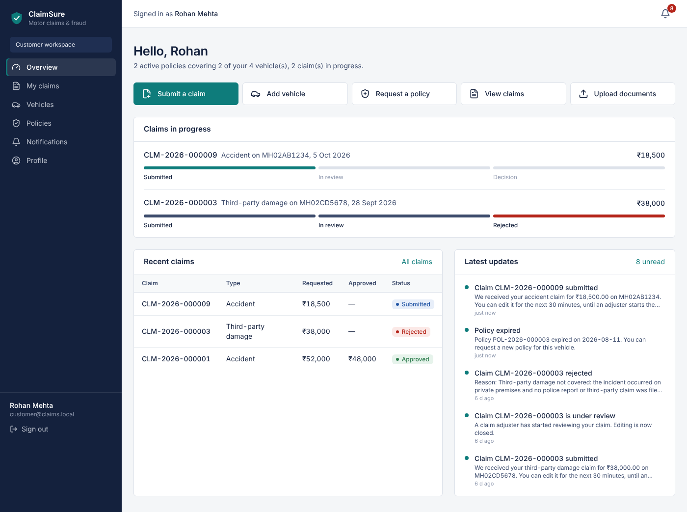
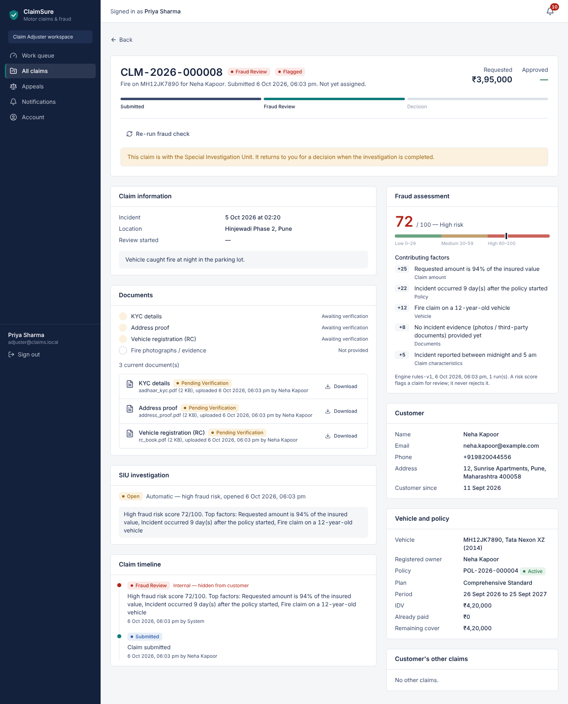
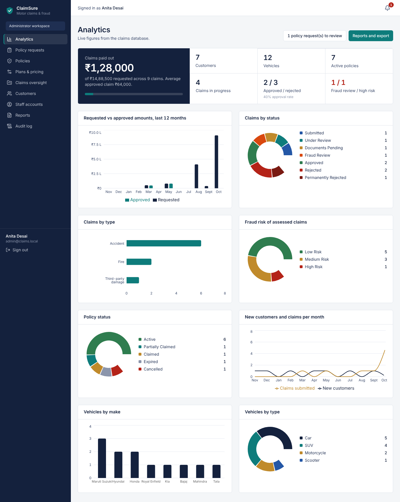

# Insurance Claim Processing & Fraud Detection Platform

A working web application for vehicle insurance. Customers insure vehicles and file claims; claim adjusters review
evidence and decide; a separate fraud-detection service scores every claim; SIU investigators examine high-risk
claims; administrators manage policies, staff and reporting. It is built from the project SRS (v1.0), the activity
and sequence diagrams, and the DFD.

| | |
|---|---|
| Backend | Python 3.11+, Django 5.2, Django REST Framework |
| Fraud service | Python, Flask 3 (separate process and API) |
| Database | MySQL 8 (InnoDB) |
| Frontend | React 18, Vite, TypeScript, Tailwind CSS, React Router, Axios, Recharts |
| Tests | 104 Django tests (run on MySQL) · 13 Flask tests · Playwright end-to-end · load check |

More documentation:
- [`docs/ANALYSIS.md`](docs/ANALYSIS.md): SRS analysis, the 16 ambiguities and how each was resolved, roles, entities, state machines
- [`docs/API.md`](docs/API.md): REST API reference
- [`docs/TRACEABILITY.md`](docs/TRACEABILITY.md): all 153 SRS requirements mapped to code, database, UI and tests
- [`docs/ENGINEERING.md`](docs/ENGINEERING.md): design decisions explained (for a viva or interview)
- [`docs/DEMO.md`](docs/DEMO.md): a 15-minute demonstration script

| Customer dashboard | Adjuster: claim in fraud review | Administrator analytics |
|---|---|---|
|  |  |  |

More screenshots, including the SIU queue, the claim wizard, mobile view and sign-in, are in `docs/screenshots/`.

---

## 1. Features

**Customer:** register with email verification · sign in, sign out, reset password · profile (email and date of
birth locked) · register vehicles (locked once insured) · request policies · 4-step claim wizard with document
upload · edit or withdraw a claim within 30 minutes · track status on a progress rail and timeline · replace rejected
documents · appeal a rejection with new evidence · in-app and email notifications · delete account (only when no
claim is in progress).

**Claim Adjuster:** work-queue dashboard · search and filter every claim · start review (locks customer editing and
assigns the claim) · verify or reject documents (with a reason) · upload and replace documents, including repair
estimates · fraud score with explained factors · request documents · escalate to SIU · approve a chosen amount ·
reject with a reason · decide appeals and whether a further appeal is allowed · re-run the fraud check.

**SIU Investigator:** queue of flagged and escalated claims with scores and factors · take an investigation · case
notes · record findings and a recommendation (permanent once completed). The claim then returns to the adjuster,
because SIU findings inform the decision but do not make it.

**Administrator:** live analytics (11 KPIs, 8 charts) · approve or decline policy requests · cancel policies ·
configure plans (existing policies keep their terms) · create staff accounts (they set their own password by email)
· activate, deactivate or unlock users · customers list · 5 filterable reports with CSV, Excel and PDF export ·
audit log. Administrators **cannot** approve or reject claims (REQ-SEC-011).

**Fraud detection:** a separate Flask API scores each claim 0–100 using 16 explainable rules (amount vs IDV, policy
age, near expiry, claim frequency, similar claims within 30 days, earlier rejections, late reporting, night-time
incident, old-vehicle fire, missing evidence, **identical evidence files reused across claims**, and more). It runs on
submission, after every edit, when an appeal reopens a claim, and on demand. High risk (60+) moves the claim to
*Fraud Review* and opens an SIU case; it never rejects the claim. Customers never see scores or reasons.

## 2. Architecture

```
 Browser (React SPA)
     │  JSON over HTTP · HttpOnly session cookie + CSRF token
     ▼
 Django REST API ──────────────► MySQL
   views (thin, permissions)        users, vehicles, policies, claims, documents,
   serializers (input/output)       fraud assessments, investigations, appeals,
   services (business rules,        notifications, audit log
     transactions, state machine)
   │            │
   │            └─► Email (SMTP, or console in development)
   ▼
 Flask fraud service  (POST /api/v1/assess, X-API-Key)
   validation → RiskScorer (rules-v1 today, ML later) → {risk_score, risk_level, flagged, factors}
```

Django owns all data. It builds a feature payload (`apps/fraud/features.py`) and sends it to Flask, which is stateless
and has no database access. Uploaded documents live on disk under random names and are only ever streamed through an
authorised API endpoint.

## 3. Folder structure

```
insurance-claims-platform/
├── backend/                     Django project
│   ├── config/                  settings, urls, wsgi
│   └── apps/
│       ├── core/                base model, error handling, numbering, seed_demo command, test factories
│       ├── accounts/            users, roles, auth, lockout, inactivity middleware, permissions
│       ├── vehicles/            vehicle registry
│       ├── policies/            plans, requests, policies, status rules, run_maintenance command
│       ├── claims/              claims, state machine (workflow.py), appeals, selectors
│       ├── documents/           uploads, validation, verification, secure download
│       ├── fraud/               Flask client, feature builder, assessments
│       ├── investigations/      SIU cases and notes
│       ├── notifications/       in-app + email
│       ├── audit/               append-only audit log
│       └── reports/             dashboards, reports, CSV/XLSX/PDF export
├── fraud-service/               Flask app (fraud_service/scoring/{base,rules,registry}.py) + tests
├── frontend/                    React + Vite + TypeScript (src/pages/{public,customer,staff,admin,common})
├── tests/e2e/demo_flow.py       browser end-to-end scenario (Playwright)
├── tests/performance/           load check for REQ-PER-001..004
├── docs/                        analysis, API, traceability, engineering, demo
└── .env.example
```

Each Django app separates `models.py`, `serializers.py`, `views.py`, `services.py` (business logic), plus
`permissions.py` / `validators.py` / `selectors.py` where needed, and its own `tests/`.

## 4. Database design

| Table | Purpose / key constraints |
|---|---|
| `accounts_user` | One table for all roles; `email` unique; lockout fields |
| `accounts_customerprofile` / `employeeprofile` | 1:1 with the user; `employee_id` unique |
| `vehicles_vehicle` | `registration_number`, `engine_number`, `chassis_number` unique; registered-owner fields |
| `policies_policyplan` | Admin-configurable product (rate, term, IDV range) |
| `policies_policyrequest` | Customer request → admin decision |
| `policies_policy` | Unique number; snapshot of plan terms; CHECK `end_date > start_date`, `0 ≤ cumulative ≤ idv` |
| `claims_claim` | References the policy only (customer and vehicle are reached through it); CHECK `approved ≤ requested`, rejected ⇒ reason, approved ⇒ amount |
| `claims_claimstatushistory` | Every transition: from, to, actor, reason, internal flag |
| `claims_appeal` | `(claim, sequence)` unique |
| `documents_claimdocument` | Type, status, SHA-256, `replaces` chain, CHECK size ≤ 10 MB and rejected ⇒ reason |
| `documents_documentreview` | Verify / reject / replace history |
| `fraud_fraudassessment` / `fraudindicator` | Every run, with payload, engine, factors |
| `investigations_investigation` / `investigationnote` | SIU case; completed ⇒ findings + recommendation (CHECK) |
| `notifications_notification` | Recipient, type, title, message, related claim, read state, email status |
| `audit_auditlog` | Append-only |

Foreign keys on history use `PROTECT` (nothing that matters can be deleted). Indexes cover the hot filters (status,
dates, `(vehicle, status)`, `(policy, incident_date, claim_type)`). Full rationale: `docs/ENGINEERING.md`.

## 5. Claim workflow

```
SUBMITTED ─start review─► UNDER_REVIEW ─approve─► APPROVED
   │  │                    │ ▲  │ ▲
   │  └ high risk ─► FRAUD_REVIEW ─SIU completes─┘ │
   │                       ▲ escalate ──────────┘ │
   │                       DOCUMENTS_PENDING ◄─request docs / resume─┘
   │                    reject ▼
   └ withdraw ─► CLOSED ◄─ REJECTED ─appeal accepted─► UNDER_REVIEW
                             └ reject again / decline, no further appeal ─► PERMANENTLY_REJECTED
```
Defined once in `backend/apps/claims/workflow.py`. Illegal transitions return HTTP 409.

## 6. Authentication and role-based authorisation

- Email + password; email must be verified; password policy of 8+ characters with upper, lower, digit and special character.
- **4 consecutive failures lock the account for 20 minutes** (server-side, row-locked counter).
- **30 minutes of inactivity** ends the session (server-side middleware; background polling doesn't count).
- PBKDF2-SHA256 hashing; HttpOnly session cookie; CSRF on every state change; rate limits on authentication endpoints.
- RBAC: role permission classes on every endpoint, plus object-level scoping (other users' records return 404). Full matrix in `docs/ANALYSIS.md §2`; tested in `apps/core/tests/test_authorization_matrix.py`.

---

## 7. Installation

### Prerequisites
- **Python 3.11–3.13**, **Node.js 18+** (20 LTS recommended), **MySQL 8.0.16+** (CHECK constraints are enforced from 8.0.16). MariaDB 10.6+ also works.
- Windows: `pip install mysqlclient` uses a prebuilt wheel. macOS: `brew install mysql-client pkg-config` first. Debian/Ubuntu: `sudo apt install default-libmysqlclient-dev build-essential pkg-config`.

### Environment variables
```bash
cp .env.example .env          # Windows: copy .env.example .env
```
Edit `.env`: set `SECRET_KEY`, `DB_PASSWORD` and `FRAUD_SERVICE_API_KEY`. Both Django and Flask read the same `.env`
from the repository root, so the shared key matches automatically. Every variable is documented in `.env.example`.

### MySQL setup
```sql
-- mysql -u root -p
CREATE DATABASE insurance_claims CHARACTER SET utf8mb4 COLLATE utf8mb4_unicode_ci;
CREATE USER 'claims_user'@'localhost' IDENTIFIED BY 'your-password';
GRANT ALL PRIVILEGES ON insurance_claims.* TO 'claims_user'@'localhost';
-- the test runner creates and drops test_insurance_claims:
GRANT ALL PRIVILEGES ON test_insurance_claims.* TO 'claims_user'@'localhost';
FLUSH PRIVILEGES;
```

### Django setup
```bash
cd backend
python -m venv .venv
# Windows: .venv\Scripts\activate      macOS/Linux: source .venv/bin/activate
pip install -r requirements.txt
python manage.py migrate
```

### Flask setup
```bash
cd fraud-service
pip install -r requirements.txt        # same virtualenv is fine
```

### Frontend setup
```bash
cd frontend
npm install
```

## 8. Running the system (three terminals)

```bash
# 1 — fraud service (port 5001)
cd fraud-service && python app.py

# 2 — Django API (port 8000); verification and reset emails print here in development
cd backend && python manage.py runserver

# 3 — frontend (port 5173); proxies /api to Django
cd frontend && npm run dev
```
Open **http://localhost:5173**.

### Loading demo data
```bash
cd backend
python manage.py seed_demo --reset     # wipes the DB and uploaded files, then seeds
```
The seeder runs the **real service layer**: claims go through submission, the live fraud service, review, document
verification, approval and rejection, SIU and appeals. The result is a database with genuine histories, documents
on disk, notifications and audit entries, spread over 12 months so the charts have data. It refuses to run if the
fraud service is down (`--allow-without-fraud` overrides this).

### Scheduled housekeeping
```bash
python manage.py run_maintenance       # expire due policies; close rejected claims past the 30-day appeal window
```
Run it daily (Windows Task Scheduler or cron). Policy expiry also runs automatically before policy listings,
dashboards and claim submission, so behaviour is correct even if the job hasn't run.

## 9. Sample credentials (after `seed_demo`)

All accounts use the password **`Demo@1234`**. These exist only in the seed command and this README, never in the frontend.

| Role | Email |
|---|---|
| Administrator | `admin@claims.local` |
| Claim Adjuster | `adjuster@claims.local`, `adjuster2@claims.local` |
| SIU Investigator | `siu@claims.local` |
| Customer | `customer@claims.local` (main demo customer), `meera.joshi@example.com` (pending appeal), `neha.kapoor@example.com` (claim in fraud review), `arjun.nair@example.com`, `fatima.shaikh@example.com`, `sanjay.iyer@example.com`, `rahul.verma@example.com` |

## 10. Running the tests

```bash
# Django — 104 tests, against MySQL (creates/destroys test_insurance_claims)
cd backend && python manage.py test

# Flask — 13 tests
cd fraud-service && python -m pytest -q

# Browser end-to-end scenario (all three servers running, demo data seeded,
# Django started with:  python manage.py runserver > django.log 2>&1)
pip install playwright && python -m playwright install chromium
python tests/e2e/demo_flow.py --django-log backend/django.log

# Performance check (REQ-PER-001..004). Login rate limiting would throttle 25 logins from one IP,
# so start Django with THROTTLE_LOGIN=1000/min for this check only.
python tests/performance/load_check.py
```

Results on the development machine (2 vCPU, MariaDB 10.11):
- Django: **104 passed** · Flask: **13 passed** · end-to-end: **28 checks passed**
- 25 concurrent signed-in users: median 380 ms, p95 875 ms, max 1.13 s (target < 2 s)
- A single login takes about 0.4 s (deliberately slow password hashing)
- Claim submission with 4 documents: 75 ms (target < 5 s) · fraud scoring: 3–5 ms (target < 10 s)

The end-to-end test registers a customer, verifies the email with the real link, adds a vehicle, is blocked on a
duplicate registration, requests a policy which the admin approves, then submits a claim. It checks that the missing
documents block submission, that a fake file is rejected, and that the customer can edit the claim. An adjuster then
starts the review (which locks editing) and rejects a document, which the customer replaces. The adjuster uploads an
estimate, verifies the documents and approves the claim, and the test checks that the policy becomes Partially
Claimed and the customer is notified. Next, an SIU investigator completes the high-risk case and the adjuster can
decide it. Finally, customers are shown to be blocked from staff data (403 / 404), admins from approving claims, and
the admin's report, Excel export and audit log are checked.

## 11. Switching to real email

Set `EMAIL_BACKEND=django.core.mail.backends.smtp.EmailBackend` plus `EMAIL_HOST`, `EMAIL_PORT`, `EMAIL_USER`,
`EMAIL_PASSWORD` and `EMAIL_USE_TLS` in `.env` (for example a Gmail app password, Mailtrap or SendGrid). Emails are
sent after the database transaction commits. A failed send never breaks the operation; it is recorded as
`email_status=FAILED` on the notification and logged.

## 12. Known limitations

- **HTTPS (REQ-SEC-015)** depends on the deployment. `ENABLE_HTTPS=true` turns on secure cookies, HSTS and the HTTPS redirect, but the localhost demo runs over plain HTTP.
- **Development servers**: `runserver` and the Flask dev server are for local use. For deployment, use Gunicorn or Waitress behind a reverse proxy that also serves the built frontend (`npm run build`).
- **Fraud model**: the engine is a transparent rule set, not a trained model. The weights are reasoned estimates rather than tuned on real fraud data. The interface is ready for an ML engine (`docs/ENGINEERING.md`).
- **Synchronous scoring and email** happen inside the request. They are fast locally; in production they would move to a task queue.
- **Document storage** is the local filesystem (`backend/media/`); there is no virus scanning beyond the type and signature checks.
- **Lock out vs denial of service**: as the SRS requires, 4 failures lock an account, so an attacker who knows an email can keep that account locked. IP rate limiting reduces this but does not eliminate it.
- **Concurrent logins**: password hashing is CPU-heavy by design, so on a 2-core laptop many users signing in in the same second queue up. Normal operations meet the 2-second target with 25 concurrent users.
- **Single currency and locale** (INR, en-IN). The UI is optimised for Chrome (REQ-QUA-006) and was tested in Chromium.
- The Google Fonts stylesheet (IBM Plex Sans) needs internet access; offline, the UI falls back to the system sans-serif.

## 13. Future improvements

ML scoring (gradient boosting trained on the stored assessment payloads) with SHAP explanations · Celery + Redis for
emails, scoring and scheduled jobs · S3 document storage with signed URLs and antivirus scanning · two-factor
authentication for staff · automatic claim assignment and SLA timers · surveyor and garage portals · payment
integration for settlements · OCR to pre-fill RC and KYC details · Docker Compose for one-command setup · CI
running the test suite on every push.
